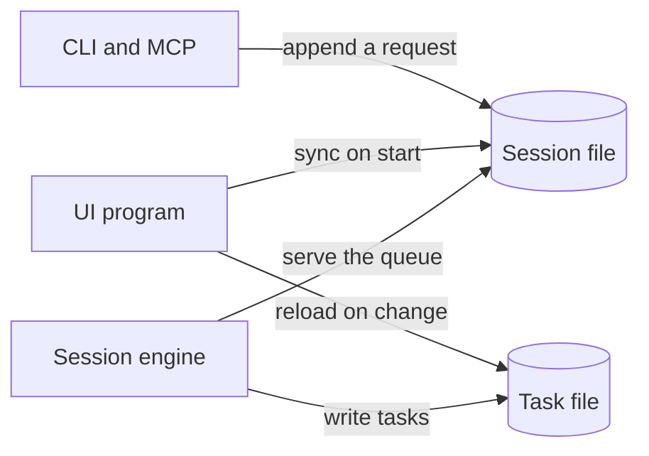
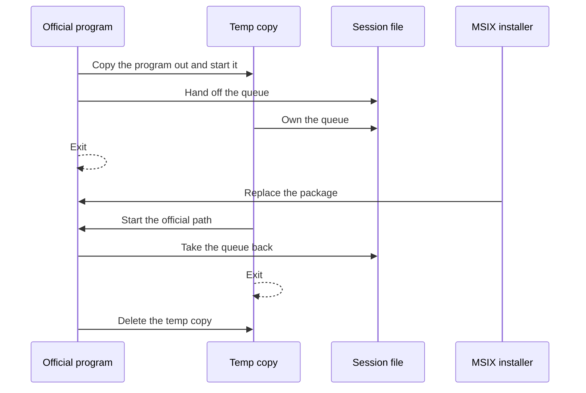
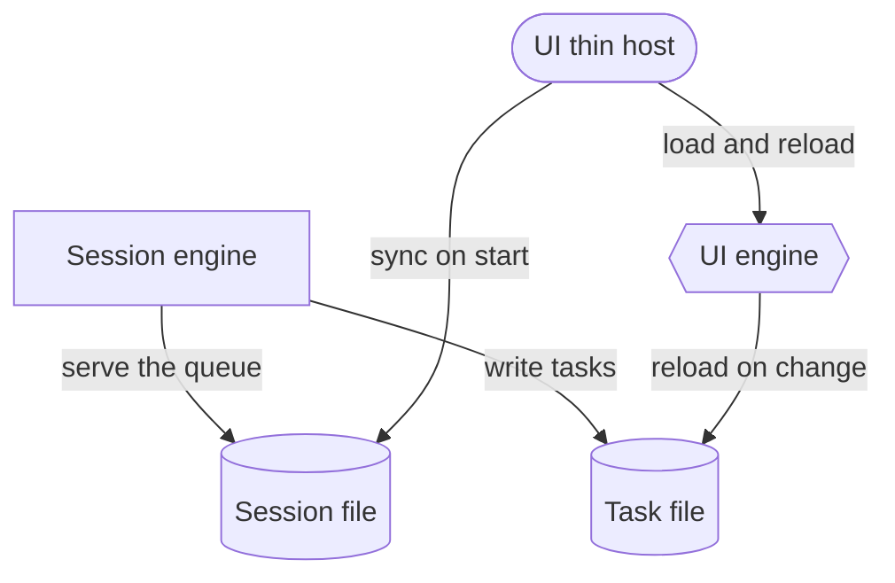
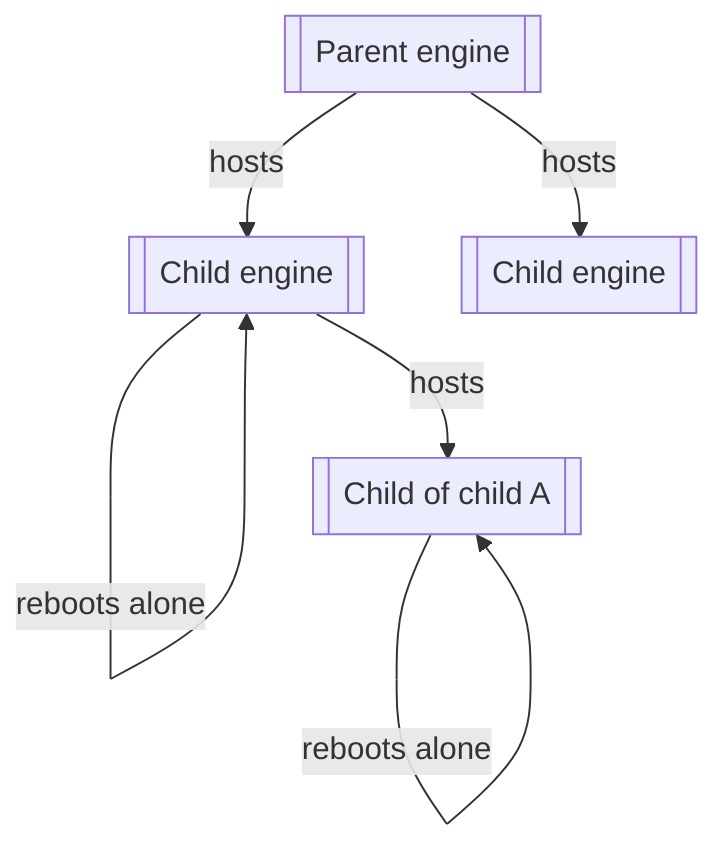

# Long-session engines

Desktop apps and agent sessions that stay open for a long time keep durable state in a session engine. The window can stay up across ordinary faults. A bizarre crash of the frame that owns the window is the downtime this pattern accepts.

Use the smallest option that meets the uptime goal. The diagrams distinguish pieces by shape. They do not use a color code.

| Shape | Piece |
| --- | --- |
| Cylinder | Session file. Survives every process. |
| Rectangle | Session engine process. Owns the queue. |
| Rounded box | UI thin host. Owns the window. |
| Hexagon | UI engine, or any swappable engine library. |
| Subroutine box | A nested engine process hosted by a parent. |

## Session engine and one UI program

The window is one program. It reads the session file when it starts. Restarting that program is acceptable.

The copy is the program files, placed outside the package. The session file stays in the per-user session folder. The copy must not open files inside the package, or the installer still sees the package as busy.

On Windows a process cannot overwrite the executable it was started from. A per-user install can replace its own official path from the temp process. Program Files needs elevation. An MSIX package is sealed: the installer replaces it, after the packaged process has exited. Your installer can see the engine's lock, drop the new build where the engine expects it, and leave the package update to that dance. An installer you do not control can still stop the process.

A new build migrates the session file before it serves. The file starts with a version. The new build runs the steps from that version up to its own, writes a new file, swaps the name, then takes requests. Store offsets from the start of the file, never raw pointers. Clients speak command bytes. They reopen the file when a generation counter moves. They do not share the engine's structs.

## UI thin host and UI engine

Use this when the window should stay open across a screen update. The host creates the window and reads the session file. The UI engine is a library the host loads. A fault in the library is reloaded by the host. The window closes only if the host itself crashes.

The session engine's update dance is unchanged. The host keeps its handle on the session file while it swaps the UI engine.

## Nested engines

The same split repeats. A parent engine hosts child engines. A child that starts crashing restarts in its own loop. The parent stays up. A child may host children of its own.

State the child must keep across its own reboot lives in the parent's session, or in a file the parent owns. The child receives that state when it starts again. A child crash does not restart the parent, the session engine, or the UI host.

## What to pick

| Goal | Option |
| --- | --- |
| Session survives a window restart | Session engine and one UI program |
| Window stays up across a screen change | Add the UI thin host and UI engine |
| One workload must crash without taking the others down | Nest that workload as a child engine |
